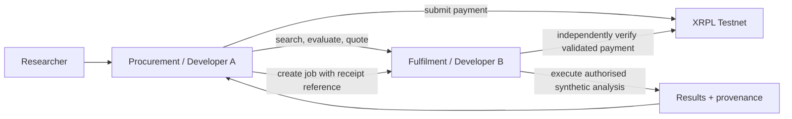

# Architecture and bounded contexts

## Shape
Two independently deployable modules, **one XRPL ledger**, one versioned HTTP contract.

## A — Procurement domain
- **Research Requests:** structured question, population, variables, purpose, budget.
- **Planning:** interprets intent; ranks offerings, with deterministic eligibility enforced by B.
- **Mandates:** approval, vendor allowlist, per-purchase/total limits, expiry; enforced by trusted signing service.
- **Payments:** create instructions, submit transaction, wait for validated finality, reconcile on retries.
- **Orchestration:** durable state, correlation IDs, status and UI.

## B — Fulfilment domain
- **Catalogue:** synthetic offerings, pricing, schemas, provider identifiers, dataset version/hash.
- **Rights:** versioned rule evaluation (commercial use, operation, purpose, access).
- **Quotes:** immutable amount, asset, destination, TTL, offering and terms snapshot.
- **Processing:** idempotent job dispatch, independent payment verification, real calculations.
- **Provenance:** input/version/code/output hashes, decisions, payment reference, timestamps.

## Integration invariants
1. B evaluates rights and issues the quote. A cannot set pricing or self-approve access.
2. A enforces a spending mandate **before signing**. B rechecks rights, quote and actual payment **before executing**.
3. Payment verification requires `tesSUCCESS` in a **validated ledger**, matching Destination, delivered Amount, Currency, Issuer, and a unique quote reference. Interpret XRPL payment metadata and delivered amount, not an untrusted request payload.
4. Job creation is idempotent via `job_id` and `quote_id`; a payment hash cannot fund unrelated jobs.
5. Never auto-resubmit an unknown/outstanding transaction without ledger reconciliation.
6. Store private keys server-side, excluded from logs and LLM prompts; no medical records on XRPL.
7. No claim of atomic payment-for-compute: the MVP is a trusted service with explicit failure/refund handling; **not** trustless escrow.

## Development topology
A and B build against shared contracts and mock implementations. A owns UI/UX; B owns sample datasets and deterministic statistics. Use separate service DBs (SQLite sufficient). Keep a single monorepo; avoid microservice infrastructure and cross-chain components.

## Demo scientific workflow
Synthetic adults-living-with-HIV cohort with BMI and hsCRP and/or VCAM-1, selected from mock offerings. Produce sample sizes, descriptive comparison and a reproducible test statistic. Explicitly mark results synthetic and not medically actionable.
